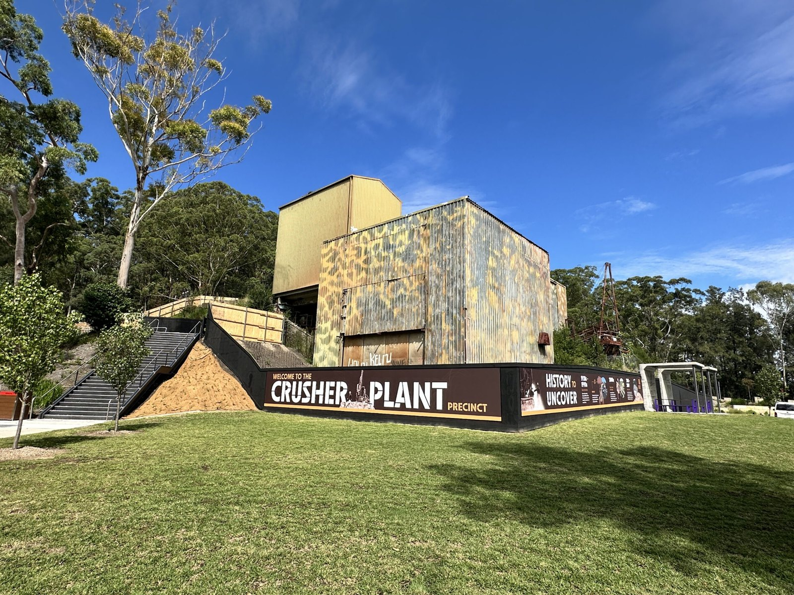
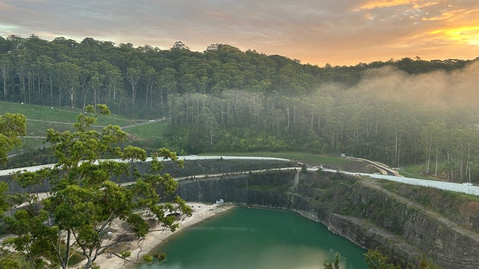

悉尼正值春末，气温逐渐回暖。位于悉尼北部的霍恩斯比区（Hornsby Shire）政府近期发布了多条社区消息，以下是其中几条。

## 废弃采石场改建为公园

*霍恩斯比公园第一期“碎石厂区”，旧厂房得到保留，前方是大片草坪。*
<small>图：霍恩斯比区政府</small>

霍恩斯比有一座废弃多年的采石场，区政府正将其改建为“霍恩斯比公园”。第一期已于今年3月28日开放：保留下来的旧碎石厂房旁新建了草坪、野餐棚和烧烤台，还有一座观景台，可以俯瞰整个旧采石场和周边林地。几段老石阶也已修缮，可沿阶步入林间。

*从高处俯瞰，旧采石场的坑底如今是一片绿色湖泊。*
<small>图：霍恩斯比区政府</small>

9月30日和10月1日，来自全球一百五十多所学校的一千多名师生来到公园，种下八百株澳洲本土植物。公园其余部分仍在施工，新运动场预计2027年年中建成。12月21日，区政府还将在碎石厂区举办一场“纸杯蛋糕聊天会”，邀请居民边吃边聊。

## 中澳神话题材油画获美术大奖

一年一度的“霍恩斯比美术奖”于10月19日揭晓。大奖由邻近瓦隆加（Wahroonga）的画家 Suxing Zhang 获得，奖金一万澳元。获奖油画英文名为 The Great Deluge（《大洪水》），作品探讨了澳洲与中国神话中，蛇形神灵都与水和变化相关联的共同点。本届共收到567件作品，84件入围。获奖及入围作品免费展出至11月1日。

## 面向长者的社区活动

区图书馆定期开设免费电脑课，帮助长者学习使用电脑、平板和电子邮件。该项目由新州政府与电信公司 Telstra 合作开展，部分课程用普通话授课，例如10月14日的一节普通话平板电脑入门课。课程很受欢迎，多节已经报满。

11月24日，区政府将首次举办“交友会”：参加者轮流与不同的人交谈，随后共进午餐。活动免费，需提前报名。11月17日上午，图书馆还有一场早茶会，附近小学的学生会分享“人与人之间保持联系的重要性”，欢迎所有人参加。

## 其他活动

11月7日（星期六）下午3点至晚上9点，霍恩斯比市中心将举办免费的“春季节”，有现场音乐、各国美食车、市集摊位和儿童游乐项目。

区政府近期还向三十多个本地社团颁发了“周年纪念奖”，表彰它们多年来对社区的贡献。

这个季节也是悉尼的蓝花楹花期。蓝花楹是一种开满紫色小花的乔木，新州政府旅游网站专门介绍了悉尼的赏花地点。
